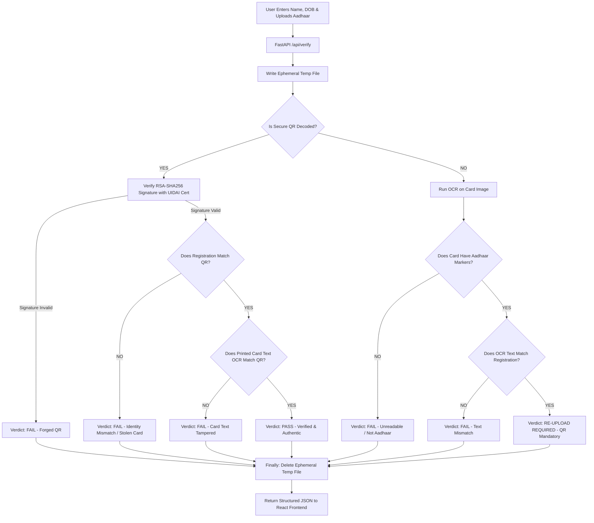

# Aadhaar Tri-Verification System — Secure Prototype

A privacy-first, zero-retention Aadhaar document verification platform featuring a **React frontend** and a **FastAPI backend**.

It replaces unreliable image heuristics with a robust **Tri-Verification Architecture** comparing:
1. **User Registration Data** (Account details)
2. **UIDAI Secure QR Data** (Cryptographic ground truth with RSA-2048 / SHA-256 digital signature)
3. **Card Printed Text** (Extracted via OCR)

---

## Table of Contents

- [Why Heuristic Checks (ELA, EXIF, Layout) Were Removed](#why-heuristic-checks-ela-exif-layout-were-removed)
- [How the Flow Works](#how-the-flow-works)
  - [1. Data Extraction & Triangulation](#1-data-extraction--triangulation)
  - [2. Scenario A: Secure QR is Decoded](#2-scenario-a-secure-qr-is-decoded)
  - [3. Scenario B: Secure QR is Missing / Blurred](#3-scenario-b-secure-qr-is-missing--blurred)
  - [4. Verification Flowchart](#4-verification-flowchart)
- [Zero-Retention: How Aadhaar Cards Are Deleted](#zero-retention-how-aadhaar-cards-are-deleted)
- [Frontend Presentation Interface](#frontend-presentation-interface)
- [Project Structure](#project-structure)
- [Setup & How to Run](#setup--how-to-run)
- [API Reference](#api-reference)

---

## Why Heuristic Checks (ELA, EXIF, Layout) Were Removed

In earlier prototypes, the system included Error Level Analysis (ELA), EXIF metadata inspection, and layout scoring. Testing against real-world digital edits demonstrated why these are unreliable for identity verification:

1. **Digital Edits Share Uniform Compression:** When an attacker edits text (e.g. changing "Dhruvil" to "Rahul") in an editor (Photoshop, Canva, Figma) and exports the image, the entire canvas is encoded together in the same JPEG compression pass. ELA yields a completely uniform error baseline, failing to detect the altered name.
2. **Lossless Sources (PNG/Screenshots):** Modern mAadhaar and DigiLocker cards are clean digital PNGs without JPEG compression artifacts, rendering ELA ineffective.
3. **EXIF is Easily Stripped:** Metadata is routinely removed by web uploaders, chat apps, and screenshot tools.

### The Cryptographic Reality
Plain text printed on a card can be forged by anyone with basic editing tools. The **UIDAI Secure QR Code** with RSA-SHA256 digital signature is the **only tamper-proof source of truth**. 

---

## How the Flow Works

```
              [ 1. Registration Data ]
                 (Name, Date of Birth)
                           ▲
                           │ Cross-Match: Identity Ownership
                           ▼
[ 2. UIDAI Secure QR Code ] ◄──────► [ 3. Card Printed Text (OCR) ]
  (Cryptographic Ground Truth)             (Anti-Tampering Cross-Check)
```

### 1. Data Extraction & Triangulation
When an Aadhaar image is uploaded:
- **UIDAI Secure QR Decoder** extracts compressed demographic fields (Name, DOB, Gender, Masked Reference ID) and verifies the RSA signature using UIDAI's public certificate.
- **OCR Engine** extracts printed card text (Name candidate, DOB, Gender, Masked Card Number, Government markers).

---

### 2. Scenario A: Secure QR is Decoded

When a valid Secure QR code is found on the image:

1. **UIDAI Digital Signature Verification**:
   - The RSA-SHA256 signature is verified against UIDAI's certificate (`keys/uidai_qr_signing_cert.cer`).
   - If signature verification fails $\rightarrow$ **FAIL** (*Forged or tampered QR code*).

2. **Registration vs Secure QR Match (Identity Ownership)**:
   - Compares the registered Name and DOB against the signed QR data.
   - If mismatch $\rightarrow$ **FAIL** (*Someone uploading a genuine card that belongs to another person*).

3. **Secure QR vs Printed Card Text Match (Anti-Tampering)**:
   - Compares the name in the signed QR with the text printed on the front of the card.
   - If an attacker keeps a genuine QR code but digitally replaces the printed name on the card (e.g., changes text to "Rahul" while QR belongs to "Dhruvil") $\rightarrow$ **FAIL** (*Document text tampering detected*).

4. **All Match**: $\rightarrow$ **PASS** ✅

---

### 3. Scenario B: Secure QR is Missing / Blurred

When the Secure QR code cannot be decoded (e.g., front-only photo or blurry image):

1. **OCR Text Extraction**:
   - Checks if the image contains valid Aadhaar markers ("Government of India", 12-digit pattern).
   - If no Aadhaar text is found $\rightarrow$ **FAIL** (*Not an Aadhaar card*).

2. **OCR vs Registration Match**:
   - **If Printed Card Text DOES NOT Match Registration:**
     - $\rightarrow$ **FAIL** (*Card details do not match registration; user prompted to verify details*).
   - **If Printed Card Text DOES Match Registration:**
     - $\rightarrow$ **RE-UPLOAD REQUIRED** (⚠️ / 🔄)
     - **Why?** Even though the printed text says the user's name, plain text can be forged. Because cryptographic proof is strictly required, the system prompts the user:
       > *"The printed text matches your registration details, but UIDAI's Secure QR was not found. Please re-upload an image containing the Secure QR code (e.g., from mAadhaar, e-Aadhaar, or the back of your physical card)."*

---

### 4. Verification Flowchart



---

## Zero-Retention: How Aadhaar Cards Are Deleted

Under UIDAI regulations, **raw Aadhaar images and unmasked numbers must never be stored**.

In `app.py`:
```python
# Ephemeral file in OS temporary storage
tmp = tempfile.NamedTemporaryFile(suffix=suffix, delete=False)
try:
    tmp.write(image_bytes)
    tmp.close()
    result = run_pipeline(image_path=tmp.name, ...)
finally:
    # Guaranteed deletion regardless of success or failure
    try:
        os.unlink(tmp.name)
    except OSError:
        pass
```
- **No Database / Cloud Storage:** The application operates completely statelessly.
- **Masked Data Only:** The system only processes and displays masked reference IDs (`XXXX-XXXX-1234`).

---

## Frontend Presentation Interface

The React frontend presents:
1. **Prominent Verdict Banner**:
   - `PASS` (Green ✅)
   - `RE-UPLOAD REQUIRED` (Amber 🔄)
   - `FAIL` (Red ❌)
2. **Action Callout Box**: Explicit instructions guiding the user when re-upload is required.
3. **Tri-Verification Data Comparison Grid**:
   - Card 1: Registration Form input
   - Card 2: UIDAI Secure QR decoded fields & signature status
   - Card 3: Card printed text (OCR) detected fields
4. **Cross-Check Matrix**:
   - Registration ↔ Secure QR
   - Secure QR ↔ Printed Card Text (Anti-Tampering)
   - Registration ↔ Printed Card Text

---

## Project Structure

```
aadhar-verify/
├── aadhar_verify/                  # Verification logic
│   ├── __init__.py
│   ├── main.py                     # Pipeline orchestrator
│   ├── qr_verify.py                # Secure QR decode + RSA-SHA256 signature verification
│   └── ocr.py                      # Tesseract OCR extraction & fuzzy cross-matching
├── frontend/                       # React frontend (Vite)
│   ├── src/
│   │   ├── components/
│   │   │   ├── VerifyForm.jsx      # Upload form (Name, DOB, File Dropzone)
│   │   │   └── Results.jsx         # Tri-verification comparison & verdicts
│   │   ├── App.jsx                 # Main React container
│   │   └── App.css                 # Clean, modern styles
├── keys/
│   └── uidai_qr_signing_cert.cer   # UIDAI public key certificate
├── samples/                        # Sample images
├── app.py                          # FastAPI backend application
└── requirements.txt
```

---

## Setup & How to Run

### 1. Start Backend (Terminal 1)
```powershell
.\venv\Scripts\activate
uvicorn app:app --reload --port 8000
```

### 2. Start Frontend (Terminal 2)
```powershell
cd frontend
npm run dev
```
Open **`http://localhost:5173`** in your browser.
